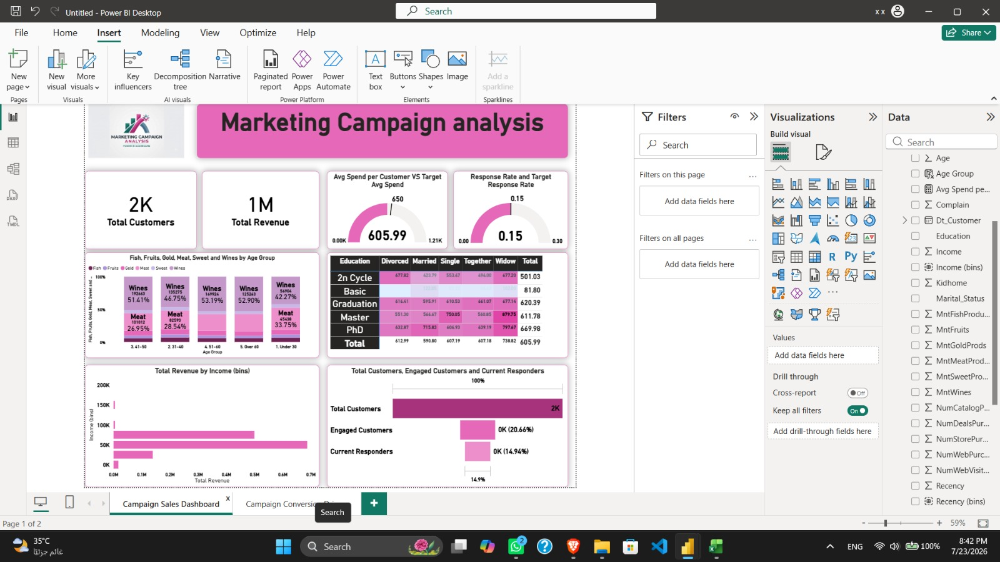
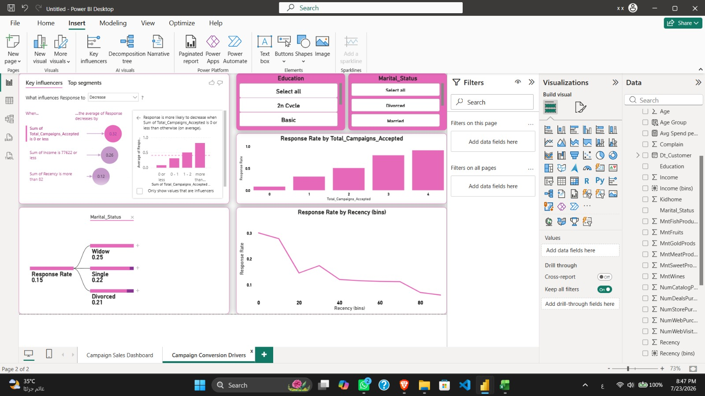

# Final Project — Marketing Campaign Response Prediction

## Business problem
Only about **14.9%** of customers accepted the last marketing campaign, so budget is spent on customers unlikely to respond. The goal is to predict who will respond and target them.

## Dataset
`marketing_campaign` — 2,240 customers, 29 columns covering demographics, spending per product category, purchase channels and past campaign results. **Target:** `Response` (1 = accepted the last offer).

## Workflow (`Final_Project_ODC.ipynb`)
1. **Cleaning**
   - Filled 24 missing `Income` values with the median
   - Removed outliers: income of 666,666 and birth years before 1930 (2,236 rows kept)
   - Grouped `Alone`, `Absurd`, `YOLO` into `Single`
   - Dropped constant columns (`Z_CostContact`, `Z_Revenue`) and `ID`
2. **Feature engineering:** `Age`, `Total_Kids`, `Total_Spend`, `Total_Purchases`, `Tenure_Days`, `Total_Campaigns_Accepted`
3. **EDA:** response rate by education, marital status, income bracket, spend and past campaigns, plus a correlation heatmap
4. **Modeling:** one-hot encoding, stratified 80/20 split, standard scaling

## Models compared
Logistic Regression, Decision Tree, Random Forest, SVM — first with default settings, then with `class_weight='balanced'`, because only about 15% of customers responded.

## Results
| Model (class-weighted) | Precision | Recall | F1 |
|---|---|---|---|
| Logistic Regression | 0.441 | 0.776 | 0.562 |
| Decision Tree | 0.515 | 0.507 | 0.511 |
| Random Forest | 0.719 | 0.343 | 0.465 |
| SVM | 0.475 | 0.716 | 0.571 |

**Final model:** class-weighted Logistic Regression with a **0.6 decision threshold** → Precision **0.511**, Recall **0.672**, F1 **0.581**. Accuracy alone was not used because the classes are imbalanced.

## Key findings
- Past campaign engagement is the strongest signal: response rises sharply with each previous campaign accepted.
- Customers with longer tenure and PhD holders are more likely to respond.
- Higher Recency (more days since last purchase) and being married or together lower the odds.

## Dashboard (Power BI)
Page 1 — *Campaign Sales Dashboard*: Total Customers, Total Revenue, Avg Spend vs target (605.99 vs 650), Response Rate vs target (0.15), spend by age group, education × marital status matrix, revenue by income, funnel of total / engaged / responding customers.

Page 2 — *Campaign Conversion Drivers*: key influencers, response rate by past campaigns accepted, by recency and by marital status.

## Files
- `Final_Project_ODC.ipynb` — notebook
- `Final_Project_Report.pdf` — full report
- `Final.pdf` — project brief
- `dashboard_page1.jpeg`, `dashboard_page2.jpeg` — dashboard screenshots

## Tools
Python (pandas, NumPy, matplotlib, seaborn, scikit-learn), Power BI, generative AI for assisted preprocessing and code
